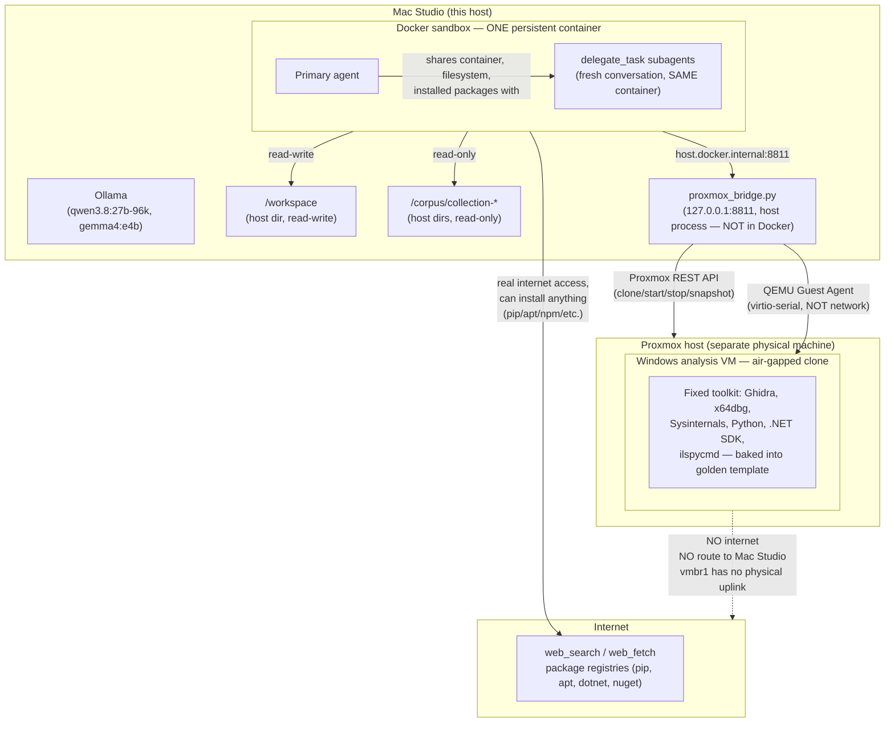

# Hermes Agent Setup — Mac Studio M4 Max (128GB)

Adds [Hermes Agent](https://github.com/NousResearch/hermes-agent) as a second client on this host, alongside [local-agent-webui](https://github.com/wataniguchi/local-agent-webui) (Open WebUI + Open Terminal). Provides autonomous/background multi-agent work and Discord-based access without disrupting the existing Open WebUI setup.

**Assumes:** `local-agent-webui` is already installed and running on this host, with Open WebUI's backend pointed at the same Ollama instance this repo configures.

## Documentation map

This repo's docs are split by what's shared infrastructure versus what's
built on top of it:

- **`README.md`** (this file) — the base Hermes/Ollama/Docker-sandbox
  setup, plus the two pieces of infrastructure shared by everything else
  in the repo: the Proxmox bridge and the isolated Windows analysis VM
  (§12). Read this first.
- **[`README_CTF_harness.md`](README_CTF_harness.md)** — a
  platform-blind traversal engine, operational-resilience/watchdog
  layer, and shared verification baseline for running Hermes against a
  problem set autonomously and unattended. Built on top of this file's
  base setup.
- **[`README_ksnctf-extension.md`](README_ksnctf-extension.md)** — the
  ksnctf platform wired into the CTF harness: acquisition, discovery,
  guarded flag submission.
- **[`README_range-assess-extension.md`](README_range-assess-extension.md)**
  — a security-range assessment workflow reusing the CTF harness's
  state-machine and guardrail patterns against a different kind of
  target (Proxmox-hosted hosts instead of a CTF platform's problems),
  and reusing the Proxmox bridge from §12 below.
- **`CHANGELOG_CTF-harness.md`**, **`CHANGELOG.range-assess-extension.md`**
  — history of what broke and how it was fixed for each extension above.
  Not needed to use anything; read only for "why does the code do this?"
  questions.
- **[`SPECIFICATION_GAMING_CASE_STUDY.md`](SPECIFICATION_GAMING_CASE_STUDY.md)**
  — a standalone case-study essay on one incident during CTF-harness
  development (an agent bypassing a tracking-file guardrail by direct
  file edit) and why it wasn't "fixed" with a code patch alone. Kept as
  written, referenced but not restated from
  [`README_CTF_harness.md`](README_CTF_harness.md).

## How it fits together

```
Ollama (single process, serves both models by name)
   ├─ qwen3.8:27b-96k    (primary reasoning)
   │      ├─ open-webui   → existing browser chat + open-terminal sandbox
   │      └─ Hermes       → CLI / gateway / Discord bot, multi-agent, persistent memory
   └─ gemma4:e4b          (fast sub-agent, Hermes only, via delegation)
```

**One Ollama instance serves both models** — unlike a per-model-process backend, there's no separate port/process per model here; requests specify which model by name, and Ollama handles loading/serving both from one endpoint (`http://localhost:11434`).

**Model policy:** `qwen3.8:27b` (Alibaba) is primary; `gemma4:e4b` (Google DeepMind) remains the fast sub-agent model. This repo previously favored US-lab models over Chinese-origin ones (Qwen, DeepSeek, Kimi, GLM) as a matter of preference — `qwen3.8`, released late August, proved strong enough on real work to justify dropping that preference.

**Why `qwen3.8:27b` is primary:** a number of models were tried before landing here. The others were dropped for one of two concrete reasons, observed directly across extended agentic use: weak reasoning specifically on CTF-style problems, or abandoning a hard challenge mid-pursuit too often rather than seeing it through. `qwen3.8:27b` held up on both counts — sustained, genuinely strong cryptanalysis and reverse-engineering work across a multi-day autonomous CTF-solving sweep, including deriving non-obvious attack paths and correctly debugging its own implementations against ground-truth references.

## Architecture at a glance

This section describes the full environment an agent (primary or subagent)
actually operates in — what it can reach, what it can install, and what's
deliberately walled off. Worth reading both as a human operator and as
context for what to expect an agent to already know about its own
affordances (this section is referenced from both extension docs' own
documentation for exactly that reason).



**The Docker sandbox is one shared, internet-capable, tool-installable
Linux environment.** Primary and every `delegate_task` subagent execute in
the *same* persistent container — same filesystem, same installed
packages, same running background processes — even though each subagent
gets a fresh, isolated *conversation* with no memory of the parent's
history or prior tool calls. If the primary `pip install`s something,
every subagent sees it too, without needing to install it again. This
container has real internet access and the agent has authority to install
whatever tools a task needs (`apt`, `pip`, `npm`, language toolchains,
`radare2`, `gdb`, whatever's actually useful) — nothing here is fixed or
pre-approved, unlike the Windows side below.

**The only interfaces between this container and the rest of the world**
are: (1) the explicit host-directory mounts (`/workspace` read-write,
`/corpus/*` read-only — nothing else on the Mac Studio's filesystem is
reachable), (2) normal internet access for research and package
installation, and (3) the Proxmox bridge, reachable at
`host.docker.internal:8811` — a narrow HTTP API, not a general network
route to anything. The range-assess extension also reaches the Proxmox
range's own network directly via Docker host networking — see
[README_range-assess-extension.md](README_range-assess-extension.md).

**The Windows VM is a completely different trust and capability regime,
on purpose.** It is a disposable clone of a golden template, on a
*separate physical machine* (the Proxmox host), with **no internet access
at all** — `vmbr1` has no physical network uplink, not just a firewall
rule, so this holds even if something inside the VM were compromised. Its
toolkit (Ghidra, x64dbg, Sysinternals, Python, .NET SDK, `ilspycmd`) is
**fixed at template-build time** — an agent cannot install anything new
into this VM at runtime; the only way new tools get added is a human
operator manually rebuilding the golden template (§12 below). The
**only** path in or out of this VM is the bridge's narrow API
(`analyze_windows_binary.py`'s `start`/`push`/`exec`/`pull`/`decompile`/
`gui-probe`/`destroy`), which itself never gives the VM a network route —
it relays through Proxmox's management API and QEMU's guest-agent channel
(virtio-serial), neither of which touches the VM's own (nonexistent)
network interface.

**Practical implication for routing a task**: if a target needs a tool
that isn't already in the Windows golden template, the Windows VM cannot
get it — that work either happens in the Linux Docker sandbox instead (if
the target is Linux/cross-platform and the sandbox's internet + install
authority can get what's needed), or it requires a human operator to
rebuild the template. [README_CTF_harness.md](README_CTF_harness.md)'s
own key design insight goes further for the CTF use case specifically:
most binary-analysis work (Ghidra, `ilspycmd`) doesn't need this VM at
all, since it analyzes a binary as data rather than executing it — the VM
is reached only when dynamic execution is genuinely required.

**`qwen3.8:27b-96k` is confirmed resident at 21GB** (`ollama ps`: `21 GB, 100% GPU, 98304 context`), with swap usage confirmed minimal at rest (`sysctl vm.swapusage`: ~63MB used of 1GB total — comfortably in the "fine" range this doc's own §5 methodology defines). **Ollama on this machine is configured to cater 1× `qwen3.8:27b-96k` plus 3× `gemma4:e4b`** resident at once, matching `OLLAMA_NUM_PARALLEL=3`/`delegation.max_concurrent_children` below.

**Caveat worth knowing: this is the configured capacity, not a heavily-exercised one.** In actual use, the primary has delegated to a subagent on only one occasion so far — real multi-way concurrent delegation load hasn't been put through its paces the way this section's own validation steps describe. The numbers above reflect residency and idle swap headroom, confirmed; genuine 3-way concurrent throughput under real delegation is still mostly theoretical at this point.

**Why `-96k` specifically:** a mid-ground choice, not a rigorously validated one. 64k was skipped in favor of 96k simply because the extra headroom was available; 128k was skipped in the other direction because Hermes's own context compression kicks in occasionally regardless, so the practical benefit of the larger window didn't seem to justify its added memory cost. Worth knowing as a reasonable default, not a number to treat as precisely tuned.

**Version requirement:** Ollama 0.22.0 or later — earlier builds predate the `llama.cpp` Gemma 4 fixes, particularly around tool-calling reliability. `gemma4:e4b` (the fast/delegation model) still depends on this.

## Repo layout

```
hermes-agent-setup/
├── README.md
├── README_CTF_harness.md              # platform-blind traversal engine + watchdog layer
├── README_ksnctf-extension.md         # ksnctf wired into the CTF harness
├── README_range-assess-extension.md   # range assessment wired into the CTF harness
├── CHANGELOG_CTF-harness.md
├── CHANGELOG.range-assess-extension.md
├── SPECIFICATION_GAMING_CASE_STUDY.md # standalone case study — see README_CTF_harness.md
├── config/
│   ├── config.yaml            # Hermes model + delegation + discord config
│   ├── .env.example           # curated subset — real keys; Discord keys are written by `hermes gateway setup`, not hand-typed
│   ├── cli-config.yaml.dist   # Hermes installer's default config, for reference
│   └── dot_env.dist           # Hermes installer's default .env template, for reference
├── docker/
│   └── hermes-sandbox.Dockerfile   # custom sandbox image — stock image + pypdf/pdfplumber baked in
├── proxmox/
│   ├── proxmox_bridge.py      # FastAPI service: Proxmox VM lifecycle + guest-exec, exposed to the sandbox via host.docker.internal:8811
│   ├── requirements.txt       # fastapi/uvicorn/requests — installed into proxmox/.venv by start-proxmox-bridge.sh
│   └── .env.example           # curated subset — real values go in proxmox/.env (gitignored), see §12 below
├── skills/
│   └── security/
│       ├── windows-binary-analysis/   # start/push/exec/pull/decompile/destroy CLI, wraps the Proxmox bridge — see §12
│       │   ├── SKILL.md
│       │   └── scripts/
│       │       └── analyze_windows_binary.py
│       ├── binary-static-analysis/     # sandbox-only static analysis (Ghidra/ilspycmd), platform-blind — see README_CTF_harness.md
│       ├── ksnctf-fetch/                # see README_ksnctf-extension.md
│       ├── ksnctf-discover/             # see README_ksnctf-extension.md
│       ├── ksnctf-submit/               # see README_ksnctf-extension.md
│       ├── ctf-solver/                  # see README_CTF_harness.md / README_ksnctf-extension.md
│       └── range-assess/                # see README_range-assess-extension.md
└── scripts/
    ├── setup-ollama-models.sh         # checks Ollama version, pulls both models
    ├── build-sandbox-image.sh         # builds hermes-sandbox:latest from docker/hermes-sandbox.Dockerfile
    ├── verify-setup.sh                # runs the full verification checklist
    ├── start-proxmox-bridge.sh        # sets up proxmox/.venv if needed, launches the Proxmox bridge on 127.0.0.1:8811
    ├── ctf-sweep-watchdog.sh          # see README_CTF_harness.md
    ├── ctf-sweep-monitor.sh           # see README_CTF_harness.md
    ├── ctf-sweep-backup.sh            # see README_CTF_harness.md
    ├── distill_progress_note.py       # see README_CTF_harness.md
    ├── check-deployment-drift.sh      # see README_CTF_harness.md
    ├── ctf-sweep-init-prompt.txt / ctf-sweep-resume-prompt.txt
    ├── range-sweep-watchdog.sh        # see README_range-assess-extension.md
    └── range-sweep-init-prompt.txt / range-sweep-resume-prompt.txt
```

No custom LaunchAgents ship from this repo — Ollama is managed via `brew services` (its own Homebrew-installed plist), and the Hermes gateway manages its own launchd service (`hermes gateway start`/`setup`). Both are covered in §7 and §8 below.

## Setup

### 1. Prerequisites

- `local-agent-webui` stack healthy, Open WebUI's backend already pointed at this same Ollama instance
- Ollama installed via `brew install ollama`, version 0.22.0 or later — check with `ollama --version`
- Git installed (only manual dependency for the Hermes installer)
- Know your available headroom: 128GB total, minus whatever Docker containers (Open WebUI, Open Terminal) already reserve. `qwen3.8:27b-96k` runs ~21GB resident; Ollama on this machine is configured to cater that plus 3× concurrent `gemma4:e4b` instances (confirmed resident/idle, not yet exercised under real concurrent delegation load) — see §5.

### 2. Install Hermes Agent

```
curl -fsSL https://raw.githubusercontent.com/NousResearch/hermes-agent/main/scripts/install.sh | bash
hermes postinstall   # installs Playwright — required for browser-based skills
hermes --version
```

Everything Hermes persists lives in `~/.hermes/` (`config.yaml`, `.env`, `SOUL.md`, `memories/`, `skills/`) — untouched by future `hermes` reinstalls/updates.

CLI-only install is what the rest of this guide assumes. If you'd rather use the native macOS app instead of/alongside the terminal, see §10 (Hermes Desktop) — it shares this same `~/.hermes/` state, so nothing below changes either way.

### 3. Pull the models

```
./scripts/setup-ollama-models.sh
```

Pulls `qwen3.8:27b` (primary) and `gemma4:e4b` (fast sub-agent), checks your installed Ollama version against the 0.22.0+ requirement, and creates the `qwen3.8:27b-96k` tag used by `config.yaml` (see the overview above for why 96k specifically).

If you ever need to recreate the tag manually:

```
ollama run qwen3.8:27b
>>> /set parameter num_ctx 98304
>>> /save qwen3.8:27b-96k
>>> /bye
```

### 4. Install the config files

```
cp config/config.yaml ~/.hermes/config.yaml
cp config/.env.example ~/.hermes/.env
```

Discord bot auth (`DISCORD_BOT_TOKEN`/`DISCORD_ALLOWED_USERS`) is written automatically by `hermes gateway setup`, not hand-typed into `~/.hermes/.env` (see §7). Fallback provider config uses the key `fallback_model:` (singular) directly in `config.yaml`, not `.env` — see the commented-out block at the bottom of `config/config.yaml` for the full shape and supported providers.

`config.yaml`'s `terminal.docker_image` points at `hermes-sandbox:latest`, a custom image (not a stock Docker Hub image) — build it before first use:

```
./scripts/build-sandbox-image.sh
```

See §11 for what this image includes and why it exists.

### 5. Residency and concurrency

Since one Ollama instance serves both models, three settings matter for keeping both resident, letting delegation's concurrent subagents actually run in parallel rather than queue, and preventing an idle-timeout unload from silently evicting the primary between uses:

```
OLLAMA_MAX_LOADED_MODELS=2   # keep both qwen3.8:27b-96k and gemma4:e4b resident at once
OLLAMA_NUM_PARALLEL=3        # match delegation.max_concurrent_children — otherwise Ollama queues the excess
OLLAMA_KEEP_ALIVE=24h        # don't let the primary idle-unload between uses (default is 5 minutes)
```

`OLLAMA_KEEP_ALIVE` still matters here even with a smaller, 21GB-class primary — Ollama's 5-minute default idle timeout is easy to hit during normal gaps between primary reasoning and subagent work, and reloading costs real time regardless of model size. Set generously (`24h` here) rather than just past the shortest expected gap — a long-running task, or being away from the machine for a stretch, should not trigger a reload.

Ollama runs as a `brew services` background daemon, launched by `launchd`, not your shell — these variables need to go in the brew-managed plist's `EnvironmentVariables` block, not `~/.zshrc`.

```
ls -la ~/Library/LaunchAgents/ | grep ollama
```

Typically `~/Library/LaunchAgents/homebrew.mxcl.ollama.plist`. Edit it:

```
<key>EnvironmentVariables</key>
<dict>
    <key>OLLAMA_MAX_LOADED_MODELS</key>
    <string>2</string>
    <key>OLLAMA_NUM_PARALLEL</key>
    <string>3</string>
    <key>OLLAMA_KEEP_ALIVE</key>
    <string>24h</string>
</dict>
```

If the plist already has an `EnvironmentVariables` dict, add these keys inside the existing one rather than creating a second — a plist can't have two `EnvironmentVariables` keys at the same level.

**Apply via `launchctl` directly, not `brew services restart`** — the latter has been observed to silently regenerate this plist from Homebrew's own template, discarding manual edits:

```
launchctl bootout gui/$(id -u)/homebrew.mxcl.ollama
launchctl bootstrap gui/$(id -u) ~/Library/LaunchAgents/homebrew.mxcl.ollama.plist
```

Confirm the edit actually took effect in the *running* process, not just the file on disk:

```
launchctl print gui/$(id -u)/homebrew.mxcl.ollama | grep -A 20 "environment ="
```

If `bootstrap` fails with a generic `Input/output error`, this can mean either the service is already loaded (harmless — verify with `launchctl print`/`curl -sf http://localhost:11434/api/tags`), or a genuine orphaned `ollama serve` process outside launchd's tracking is holding the port (check `ps aux | grep "ollama serve"` — exactly one process should exist; `kill` any extras, confirm `lsof -i :11434` is clear, then re-`bootstrap`). As a last resort, `sudo launchctl bootstrap ...` surfaces a more specific error than the plain version.

**Verify coexistence properly — memory totals alone can be misleading.** Set an explicit keep-alive on both models directly (removes any doubt about whether the env var is actually live) and check residency immediately, back-to-back:

```
ollama run qwen3.8:27b-96k --keepalive 30m "reply with just the word ok"
ollama run gemma4:e4b --keepalive 30m "reply with just the word ok"
ollama ps
```

Both should show resident. Then confirm it holds under real concurrent load, not just at rest:

```
for i in 1 2 3; do
  curl -s -w "req $i: %{time_total}s\n" http://localhost:11434/api/chat \
    -d '{"model":"gemma4:e4b","messages":[{"role":"user","content":"Count slowly from 1 to 50, one number per line."}],"stream":false}' \
    -o /tmp/conc_$i.json &
done
wait
ollama ps
```

Both models should still show resident afterward.

**The real signal for genuine memory pressure is swap, not `top`'s used/free split** — macOS opportunistically fills spare RAM with reclaimable file cache, which makes raw "used" memory look alarming even when the system is fine. Check the number that actually matters:

```
sysctl vm.swapusage
```

A `used` figure in the low hundreds of MB or less, and not climbing between checks, means you're fine regardless of how full `top`'s `PhysMem` line looks. `memory_pressure`'s own `System-wide memory free percentage` line is a second, OS-computed confirmation worth checking alongside it.

### 6. Delegation — routing subagents to the fast model

`delegation:` lets the primary *dynamically* spawn concurrent subagents mid-task via the `delegate_task` tool — e.g. "research these three things in parallel." This only fires when the primary decides a task benefits from it. Without an explicit `delegation:` block, subagents default to the parent's own model rather than the fast one.

`max_concurrent_children` defaults to 3, with no hard ceiling — nested delegation (subagents that can themselves delegate further) is off by default and needs `delegation.max_spawn_depth` raised explicitly, since each extra level multiplies concurrent load and cost.

To verify subagents are actually landing on the fast model rather than silently inheriting the primary: run a delegation prompt in an interactive `hermes chat` session (not `-q` — a backgrounded `delegate_task` orphans if the CLI process exits before it finishes) while watching:

```
ollama ps
```

Both models should show as active/resident during a real delegation.

### 7. Discord gateway

1. [Discord Developer Portal](https://discord.com/developers/applications) → New Application
2. **Bot** tab → enable **all three privileged intents**: **Presence Intent**, **Server Members Intent**, and **Message Content Intent**. Discord rejects the gateway connection outright (`discord.errors.PrivilegedIntentsRequired`) if any intent the adapter requests isn't enabled. Scroll down and confirm the page actually saved — it doesn't always auto-save on toggle.
3. **Reset Token**, copy it somewhere safe
4. Generate an invite URL: scopes `bot` + `applications.commands`; permissions: View Channel, Send Messages, Read Message History, Send Messages in Threads, Add Reactions. Invite to your server.
5. Run the setup command and follow its prompts (paste the token when asked):

```
hermes gateway setup
```

This writes `DISCORD_BOT_TOKEN` and `DISCORD_ALLOWED_USERS` into `~/.hermes/.env` for you.

6. Restart the gateway:

```
hermes gateway restart
hermes gateway status
```

**You must @mention the bot for it to respond** — `discord.require_mention: true` is the default (see `config.yaml`'s `discord:` block). A plain message with no mention is silently ignored; this is expected behavior, not a bug. Test with `@Hermes Agent hello` in a private channel first. If you'd rather not @mention every time in a specific channel, set `discord.free_response_channels` to that channel's ID.

Green/online bot status + a reply to a direct mention confirms the full chain (gateway → provider → Discord) is working. If the bot connects but never replies, check the mention requirement before anything else — it's the most common cause and easy to overlook.

### 8. Auto-start at login

Two services, each managing its own launchd registration — nothing custom needed from this repo:

- **Ollama**: `brew services start ollama` installs and manages `homebrew.mxcl.ollama.plist` automatically. `brew services list` confirms it's running.
- **Hermes gateway**: `hermes gateway setup`/`start` installs and manages `~/Library/LaunchAgents/ai.hermes.gateway.plist` automatically. `hermes gateway status` confirms supervision.

### 9. Verify

```
./scripts/verify-setup.sh
```

Runs through: Ollama reachability, both models pulled, a live tool-calling sanity check, Hermes CLI response, gateway status. Confirm the real Discord reply and Open WebUI's continued normal operation manually.

### 10. Optional: Hermes Desktop as an additional frontend

Nous Research also ships a native macOS app ("Hermes Desktop") — not covered by this repo's setup, and **nothing here needs to change to use it**. It's a fully separate native app that reads the same `~/.hermes/` state (config, memory, skills, sessions) this repo already sets up, so it doesn't touch Open WebUI's existing connection to Ollama at all.

- **No config changes required** — it shares `config.yaml`/`.env` automatically once installed; delegation and memory are already available the moment you open it.
- **No `API_SERVER_ENABLED` needed** — that's only for HTTP-based clients like Open WebUI; Desktop talks to the local runtime directly.
- **Download**: from the official Hermes Desktop site (`.dmg` installer), not via Homebrew or `install.sh`.
- **Status**: public preview as of this writing (shipped June 2026) — treat with a bit more caution than the CLI until it matures.
- Adds: a native chat window with streaming tool output, a file browser pane, side-by-side previews of web pages/files/tool output, and voice input.

**Known limitation: Desktop does not reliably apply `terminal.backend: docker`.** With `terminal:` fully and correctly configured in `~/.hermes/config.yaml` (§11), a Desktop session asked to read a Docker-mounted path fell back to running the command directly on the host instead — no container was created, no error was shown to the user, and the model simply reported the path as not found (having actually listed the real host root directory). The same request via `hermes chat -q` and via the Discord gateway both worked correctly and created the sandbox container as expected, confirming the config itself is correct and the gap is specific to Desktop. Nous Research's own issue tracker documents at least one other case of Desktop's Docker-backend launch path diverging from the CLI/gateway's, so this looks like a real product gap rather than a one-off misconfiguration. This limitation is independent of which model backend (Ollama, MLX, anything else) is in use — it's about the Docker sandbox specifically, not model serving.

**Until this is fixed upstream, don't rely on Desktop for anything that needs the sandboxed corpus/deliverables setup in §11 — use `hermes chat` or the Discord gateway instead.** Desktop remains fine for everything that doesn't require the Docker terminal backend.

### 11. Subagent filesystem and shell access

By default, Hermes's Docker terminal backend doesn't expose any host filesystem to subagents — everything is opt-in via `terminal.docker_volumes`. This is what makes it possible to give different directories different trust levels:

```
terminal:
  backend: docker
  docker_volumes:
    - "/path/to/host/docs-collection-1:/corpus/collection-1:ro"
    - "/path/to/host/docs-collection-2:/corpus/collection-2:ro"
    - "/path/to/host/hermes-deliverables:/workspace"
  docker_run_as_host_user: true
  container_persistent: true
```

Fill in real host paths before use — the ones in `config/config.yaml` are placeholders.

**Verify via CLI or Discord, not Desktop** — see §10's known limitation above.

**How the enforcement actually works:** every terminal, file, and execute call — from the primary agent or any `delegate_task` subagent — routes through this one Docker container. The read-only vs. read-write split is enforced by the mount itself (`:ro` vs. no suffix), at the kernel level, not by which `toolsets` a given delegation call was given. A subagent can't write to a `:ro`-mounted path no matter what it attempts.

- **Read-only document directories** (`/corpus/*`): mount each source directory separately with a `:ro` suffix. Don't try to unify scattered host directories with symlinks first — Docker bind-mounts don't follow a symlink to a target outside the mounted directory, so a symlink tree mounted alone will show up broken inside the container. Instead, mount each real source directory individually, choosing container-side paths that already look unified (`/corpus/collection-1`, `/corpus/collection-2`, etc.).

- **Deliverables directory** (`/workspace`): a plain read-write host bind mount. Persistence across sessions, projects, and chats is automatic and doesn't depend on `container_persistent` — that flag only affects in-container state (installed packages, etc.), not this bind-mounted data, which lives on the host disk regardless of container lifecycle.

- **`docker_run_as_host_user: true`**: without this, files written to `/workspace` come out root-owned on the host. Works with `hermes-sandbox:latest` (built on the same base as the stock image) — not with Hermes's own bundled image, which needs to start as root internally.

- **PDF text extraction**: handled by building a custom sandbox image with `pypdf`/`pdfplumber` baked in, rather than installing them ad hoc into a running container. Installing via `docker exec -u root pip install ...` only persists for that one container instance — the moment it's removed (mount changes, troubleshooting resets, anything covered elsewhere in this doc that says "remove the existing containers"), the packages are gone and need reinstalling. Baking them into the image itself means every future container has them from the start, regardless of how many times containers get recreated.

    Build once (and again any time `docker/hermes-sandbox.Dockerfile` changes):

    ```
    ./scripts/build-sandbox-image.sh
    ```

    `config.yaml`'s `terminal.docker_image` already points at `hermes-sandbox:latest`. If you have existing containers running from the old stock image, remove them so the next request creates a fresh one from the new image:

    ```
    docker ps -a | grep hermes-
    docker rm -f <container_id> [<container_id> ...]
    hermes gateway restart
    ```

    A small reusable helper written to `/workspace/extract_pdf.py` (a plain host file via the bind mount) gives subagents a single consistent extraction command:

    ```
    docker exec <container_id> bash -c 'cat > /workspace/extract_pdf.py << "PYEOF"
    import sys, pdfplumber
    with pdfplumber.open(sys.argv[1]) as pdf:
        print("\n".join(p.extract_text() or "" for p in pdf.pages))
    PYEOF'
    ```

    Instruct subagents to use `python3 /workspace/extract_pdf.py <path>` rather than `read_file` on a PDF directly — `read_file` returns raw binary, which wastes time and tokens as the model works out on its own that it isn't usable text.

    If you'd rather not build a custom image for some reason, the manual per-container fallback still works, just needs repeating after every container recreation:

    ```
    docker ps -a | grep hermes-
    docker exec -u root <container_id> pip install pypdf pdfplumber
    ```

**SSH keypair baked into the sandbox image**: `docker/hermes-sandbox.Dockerfile` also bakes in an SSH keypair under both `/home/hermes/.ssh` and `/root/.ssh` (the same key, giving `sudo ssh` access from either account). This is the client-side half of the credential pair behind the range-assess extension's SSH-based local host audit (see [README_range-assess-extension.md](README_range-assess-extension.md)) — the matching public key is authorized on the server side, on every range target host. It's recorded here, not only in that extension's own doc, because it's part of the shared sandbox image every skill runs in, not something range-assess introduces on its own. As with the rest of this image, build-tested status matters: see the Dockerfile's own header for its current confirmed-vs-untested caveats.

Leaf subagents (the kind `delegate_task` spawns by default) can't call Hermes's `memory` tool directly. The natural pattern for turning read documents into persistent knowledge: have the subagent read and summarize, return the summary to the primary, and let the primary decide what's worth writing to memory — this is also what keeps large raw documents out of the main context window in the first place.

### 12. Isolated Windows analysis VM (Proxmox)

For CTF/security work needing a real Windows environment — Docker here
only runs Linux containers, so Windows PE analysis, Windows-targeted pwn
challenges, and Windows malware triage can't run in the sandbox above.
Adds an air-gapped Windows VM on a separate Proxmox host, driven by
Hermes through a small HTTP bridge and a `windows-binary-analysis` skill.

**Not needed for the rest of this repo to work** — entirely separate
from Ollama/Hermes/the Docker sandbox above. The range-assess extension
also depends on this section's Proxmox bridge (for its own, Linux/Windows
range hosts rather than the Windows analysis VM specifically) — see
[README_range-assess-extension.md](README_range-assess-extension.md).

**Status:** golden template (`win10-golden`, JIS-layout Windows 10, full
toolkit) built and snapshotted. Bridge service (`proxmox/proxmox_bridge.py`)
proven end-to-end: clone → start → guest-exec → destroy, tested both locally
on the Proxmox host and cross-machine from the Mac Studio.

#### Hardware

| Component | Spec |
|---|---|
| Host | iMac Retina 5K, 27", Late 2015 (no T2 chip — no Secure Boot/external-media restrictions apply) |
| CPU | 3.2GHz quad-core Intel Core i5 |
| RAM | 24GB 1600MHz DDR3 |
| Hypervisor | Proxmox VE (bare metal) |

#### Storage architecture

Three tiers, split by write pattern. The HDD is a **5400 RPM SMR** drive
(Seagate ST8000DM004) — tolerates sequential/read-mostly access well, degrades
badly under sustained random writes. This is why templates and working copies
live on different storage.

| Tier | Device | Proxmox storage ID | Type | Role |
|---|---|---|---|---|
| Host | Internal 128GB SSD | `local` | dir | Proxmox OS, ISOs, config only |
| Hot | External 240GB USB SSD (Buffalo, UAS) | `hot-ssd` | LVM-thin | Active/working VM disks — anything under snapshot/rollback churn |
| Cold | Internal 8TB HDD (SMR) | `vmdata` | ZFS pool | Golden templates (write-once, read-many), samples, backups |

Per-exercise workflow:

```bash
qm clone 9000 <new-id> --full 1 --storage hot-ssd --name exercise-<new-id>
# ... run the exercise, snapshot/rollback freely on hot-ssd ...
qm stop <new-id>
qm destroy <new-id>   # discard when done — no cumulative drift
```

**Full clones (not linked)** are required here since template (`vmdata`) and
working copy (`hot-ssd`) live on different storage backends. Expect the clone
itself to take a while — observed **30-60+ minutes for a 64GB template**
copying off the SMR source, even though it's the drive's best-case sequential
access pattern. This is why `proxmox_bridge.py`'s task-wait timeout is set to
2 hours, not a shorter default.

#### Network architecture

Two bridges, kept structurally separate — `vmbr1` has **no physical uplink
at all**, not just a firewall rule:

```
# /etc/network/interfaces
auto vmbr1
iface vmbr1 inet manual
    bridge-ports none
    bridge-stp off
    bridge-fd 0
```

| Bridge | Attached to | Purpose |
|---|---|---|
| `vmbr0` | Physical NIC | Proxmox host management (web UI, API, SSH) |
| `vmbr1` | Nothing | Isolated network for analysis VMs — no route to LAN or internet |

Any VM analyzing untrusted binaries or CTF material attaches to `vmbr1` only.
(The range-assess extension's own golden images use a different, routed
network — see [README_range-assess-extension.md](README_range-assess-extension.md).)

#### Golden template: `win10-golden` (VMID 9000)

**Japanese-edition Windows 10 22H2 x64** — not English + language pack. An
earlier attempt to retrofit JIS keyboard support onto an English install via
registry overrides, driver swaps, and offline `.cab` language packs all
failed to stick reliably; the native JP-edition ISO ships JIS as the default,
no retrofitting needed. If future templates don't need Japanese input, an
English ISO is simpler — this detour is specific to this operator's needs.

```bash
qm create 9000 \
  --name win10-golden \
  --memory 8192 --cores 4 --cpu host \
  --machine q35 --bios ovmf \
  --efidisk0 vmdata:0,efitype=4m,pre-enrolled-keys=0 \
  --scsihw virtio-scsi-pci \
  --scsi0 vmdata:64,cache=writeback,discard=on \
  --ide2 local:iso/<Windows-JP-ISO-filename>.iso,media=cdrom \
  --ide3 local:iso/virtio-win-<version>.iso,media=cdrom \
  --net0 virtio,bridge=vmbr1 \
  --vga std \
  --agent enabled=1,fstrim_cloned_disks=1 \
  --ostype win10
qm set 9000 --boot order=ide2;scsi0;net0   # ide2 first so a blank disk boots the installer
```

**q35 IDE limitation:** only two IDE optical slots are actually usable
(whatever's assigned to `ide2`/`ide3`) — a third (`ide0`, etc.) is silently
accepted into the config but never presents a device to the guest. Reuse
`ide2`/`ide3` for later media swaps (e.g. toolkit delivery ISO) rather than
adding new slots.

**OVMF boot-entry quirk:** a freshly created VM with an empty `scsi0` can
show `BdsDxe: failed to start Boot0002 "UEFI QEMU DVD-ROM..."` and fall
through to the interactive boot-device picker even with a valid, correctly
attached ISO. In practice this resolved itself once `scsi0` had no competing
bootable disk to fall back to — if it recurs, **Boot Maintenance Manager →
Boot From File → `\EFI\BOOT\BOOTX64.EFI`** boots directly, bypassing the
stale entry.

Toolkit installed via one-shot ISO transfer (build on the Proxmox host,
attach as temporary CD-ROM, copy in, detach):

```bash
genisoimage -o /var/lib/vz/template/iso/toolkit.iso -J -R /path/to/staged/installers
qm set 9000 --ide2 local:iso/toolkit.iso,media=cdrom
# install inside guest, then:
qm set 9000 --delete ide2
```

| Tool | Notes |
|---|---|
| Sysinternals Suite | Portable, no installer. **Accept each tool's EULA once interactively before snapshotting** — it's a blocking modal that would hang unattended `guest-exec` calls otherwise |
| x64dbg (snapshot build) | Portable. Confirm Windows Defender isn't flagging it before snapshotting (unsigned-binary heuristic false positives happen occasionally) |
| PE-bear | Portable; vs17 build needs VC++ 2015-2022 Redistributable installed alongside it |
| Ghidra | Needs a JDK first (Temurin/Eclipse Adoptium, matching whatever version the specific Ghidra release states) — **the release zip extracts with an extra top-level folder** (`ghidra_X.X_PUBLIC/`); move contents up one level or `ghidraRun.bat` won't be where expected. **Does not handle .NET/MSIL binaries well** — use ilspycmd instead for those (see below). **For scripting: use PyGhidra as a plain Python package, not `analyzeHeadless.bat -postScript`.** Ghidra 12.x's classic `analyzeHeadless -postScript some.py` path is genuinely broken in practice — `.py` scripts default to PyGhidra's runtime, which isn't bootstrapped for headless use, and `# @runtime Jython` just hits a different error since the Jython extension isn't installed either. The actual fix, confirmed working: install the `pyghidra` Python package **offline** using the wheel Ghidra ships with itself — `python -m pip install --no-index -f C:\Tools\ghidra\Ghidra\Features\PyGhidra\pypkg\dist pyghidra` — then write plain Python scripts that `import pyghidra; pyghidra.start(); with pyghidra.open_program(path) as flat_api: ...` and run them directly via `python.exe`, never through `analyzeHeadless.bat` at all. See the skill's `pyghidra_tool.py` and the `ghidra-inventory`/`ghidra-decompile` subcommands |
| .NET SDK + ilspycmd | For decompiling .NET (MSIL/CIL) binaries back to readable C# — see the `decompile` skill subcommand. Install the .NET SDK (not just the runtime) via the offline installer, then `dotnet tool install --global ilspycmd --tool-path C:\Tools\ilspy` (use `--tool-path`, not a plain `--global` install — the default global-tools location is under the per-user profile, which SYSTEM-context `guest-exec` calls can't see, same PATH pitfall as Python earlier). Add `C:\Tools\ilspy` to the machine-wide PATH |
| Python | Install **for all users**, not per-user — Hermes's later `guest-exec` calls run in the **SYSTEM** account context, which never sees a per-user `PATH` entry. `python-3.13.15-amd64.exe /passive InstallAllUsers=1 PrependPath=1` |

All tool directories added to the **machine-wide** `Path` (System variables,
not User variables) — same SYSTEM-context reasoning as Python above.

**Guest agent must be confirmed working before snapshotting** — this is what
`proxmox_bridge.py` depends on entirely:

```bash
qm agent 9000 ping
qm agent 9000 get-osinfo   # should return real Windows version info, not an error
```

If `qm config 9000 | grep agent` shows `enabled=1` but the guest doesn't
respond, a **full VM restart** (`qm shutdown` + `qm start`, not a
Windows-side reboot) is required — this is a QEMU launch-time device, not
hot-pluggable.

Once confirmed and toolkit installed:

```bash
qm shutdown 9000
qm snapshot 9000 clean-tooled
```

**`ide3` (the virtio-win reference) must be deliberately KEPT on the golden
template — do not delete it, even though it looks like leftover cruft from
template build.** Its presence as an *existing device* is required
infrastructure: the Hermes skill's large-file transfer path
(`analyze_windows_binary.py`'s ISO-attach mechanism) works by swapping
`ide3`'s media on a running clone, which is instant and reliable — but
QEMU does not hotplug a brand-new IDE device into a running VM under any
circumstances, confirmed by direct testing. If `ide3` doesn't exist on a
clone, the large-file push path breaks with no new drive letter ever
appearing, no matter how long you wait. Only `ide2` (the Windows installer
reference) should be deleted before the final snapshot — see the toolkit
section above.

#### Bridge service (`proxmox/proxmox_bridge.py`)

Runs on the **Mac Studio**, not the Proxmox host — Hermes's Docker sandbox
reaches it via `host.docker.internal:8811`. Two channels to Proxmox, kept
deliberately separate:

- **VM lifecycle** (clone/start/stop/snapshot/rollback/destroy) → Proxmox
  REST API, authenticated via a scoped API token
- **In-guest exec + file transfer** → QEMU Guest Agent, relayed through
  Proxmox's `/agent/*` endpoints over virtio-serial — **never** the guest's
  own network interface, which stays air-gapped on `vmbr1` throughout

##### One-time Proxmox-side setup

Create a scoped token — **do not reuse `root@pam`**:

```bash
pveum user add hermes-bridge@pve
pveum aclmod / -user hermes-bridge@pve -role PVEVMAdmin
pveum user token add hermes-bridge@pve bridge-token --privsep 0
```

The `value` field printed by the last command is `PVE_TOKEN_SECRET` —
**shown once, not retrievable afterward**, only regeneratable.

**`PVEVMAdmin` at `/` is not sufficient by itself** — three additional grants
were needed before a clone actually succeeded, each surfaced one at a time as
a separate `403`:

```bash
# Datastore.AllocateSpace — needed on clone source/destination
pveum aclmod /storage/hot-ssd -user hermes-bridge@pve -role PVEDatastoreUser
pveum aclmod /storage/vmdata  -user hermes-bridge@pve -role PVEDatastoreUser

# Datastore.AllocateTemplate — a distinct, more specific privilege than
# AllocateSpace, required for /storage/upload (the ISO-attach large-file
# transfer path writes here). PVEDatastoreUser does NOT include this —
# needs the broader PVEDatastoreAdmin role on this one storage pool.
pveum aclmod /storage/local -user hermes-bridge@pve -role PVEDatastoreAdmin

# SDN.Use — PVEVMAdmin does not carry this privilege under any path;
# needs a dedicated role
pveum role add SDNUser -privs "SDN.Use"
pveum aclmod /sdn/zones -user hermes-bridge@pve -role SDNUser
```

Confirm the final ACL set with `pveum acl list` before moving on.

**Firewall — restrict who can reach the API at all:** Datacenter → Firewall
→ allow TCP/8006 from the Mac Studio's IP only, default-drop otherwise. Do
this before running the bridge against anything but `localhost`.

##### Running it

```bash
cp proxmox/.env.example proxmox/.env
# edit proxmox/.env — real PVE_HOST, PVE_TOKEN_SECRET, etc.
./scripts/start-proxmox-bridge.sh
```

##### Verifying end-to-end

```bash
curl -X POST http://127.0.0.1:8811/vm/clone \
  -H "Content-Type: application/json" \
  -d '{"template_vmid": 9000, "new_vmid": 9101, "name": "bridge-test"}'
# expect a long wait — see clone-duration note above

curl -X POST http://127.0.0.1:8811/vm/9101/start
curl -X POST http://127.0.0.1:8811/vm/9101/exec \
  -H "Content-Type: application/json" \
  -d '{"command": ["cmd", "/c", "where", "x64dbg.exe"]}'
curl -X DELETE http://127.0.0.1:8811/vm/9101   # auto-stops first if still running
```

##### Concurrency (multiple Hermes subagents, one shared VM)

Multiple subagents calling `exec`/`file` concurrently against **the same
`vmid`** is safe — each `/vm/{vmid}/exec` call spawns an independent
QEMU Guest Agent process, and uvicorn handles each request in its own
thread, so nothing in the bridge serializes concurrent calls against one
vmid. The primary should `clone`/`start` once and share that `vmid` with
subagents — never have each subagent clone its own VM: cost multiplies, and
concurrent clones from the same SMR source likely make each other slower,
not just duplicate the 30-60 min wait.

**Known gap:** the skill script's default vmid picker
(`9100 + time.time() % 400`) has no collision check — fine for one shared
vmid across subagents of a single task, but two independent analysis
*sessions* started around the same moment could theoretically collide.
Pass an explicit `--vmid` if running more than one session concurrently.

#### Open items

- [x] Wire the bridge into an actual Hermes skill — `skills/security/windows-binary-analysis/`
- [x] Test `/vm/{vmid}/file` write/read endpoints directly — confirmed working
      both directions, including binary content; read side requires decoding
      the `content` field as `latin-1` (see troubleshooting table below)
- [x] Confirm `host.docker.internal:8811` is reachable from inside a running
      `hermes-sandbox` container — verified via `curl -s
      http://host.docker.internal:8811/openapi.json` returning real JSON
- [ ] Consider a second golden template for Linux-based pwn challenges,
      also on `vmdata`, also cloned to `hot-ssd` per exercise
- [ ] Consider pre-cloning a small standby pool of ready VMs to avoid the
      30-60 min clone wait sitting in the critical path of every exercise
- [x] Split static (Ghidra/ilspycmd) analysis out of this VM's dependency
      entirely — done via the `binary-static-analysis` skill, which runs
      entirely in the Docker sandbox with no Proxmox round-trip; this VM
      (via `windows-binary-analysis`) is now narrowed to genuinely
      VM-dependent operations only (start/push/exec/gui-probe). See
      [README_CTF_harness.md](README_CTF_harness.md#the-key-design-insight)

#### First real use

Ask Hermes (chat or Discord) something like: *"There's a Windows pwn
challenge binary at `/workspace/samples/chall.exe` — analyze it in the
isolated VM and tell me what you find."* The `windows-binary-analysis` skill
should trigger automatically based on its description; it'll warn you about
the clone wait before starting.

#### Proxmox/Windows-VM troubleshooting

| Symptom | Likely cause | Fix |
|---|---|---|
| OVMF console shows `BdsDxe: failed to start ... DVD-ROM` on a fresh VM, falls to boot-device picker | Stale/generic boot entry, not a real device/ISO problem | Boot Maintenance Manager → Boot From File → `\EFI\BOOT\BOOTX64.EFI`; resolves once the OS is actually installed |
| Windows installer says "No signed device drivers were found" loading VirtIO SCSI driver | Browsed to the wrong folder depth | Path must be exactly `\vioscsi\w10\amd64`, not a level above |
| Attaching a third install-media ISO on a q35 VM silently does nothing | q35 only exposes 2 usable IDE optical slots | Reuse existing `ide2`/`ide3`, don't add `ide0`/`ide1` for optical media |
| `where <tool>.exe` fails inside guest even after `setx ... /M` | `setx` (or the modern Settings-app language/keyboard flow) needs internet in some code paths, or a stale environment in an already-running guest-agent service | For PATH specifically: edit via System Properties → Environment Variables → **System variables** GUI directly, or confirm with `reg query "HKLM\SYSTEM\...\Environment" /v Path` before assuming a failure |
| `qm agent <vmid> ping` returns "No QEMU guest agent configured" | `--agent enabled=1` not set, or set but VM not restarted | `qm set <vmid> --agent enabled=1`, then full `qm shutdown`/`qm start` — config-only changes to hardware need a real relaunch, not a guest-side reboot |
| Bridge clone call returns `403 Datastore.AllocateSpace` | Token's role doesn't include storage allocation | `pveum aclmod /storage/<name> -user hermes-bridge@pve -role PVEDatastoreUser` on both source and destination storage |
| Bridge clone call returns `403 SDN.Use` even after granting `PVEVMAdmin` on the SDN path | `PVEVMAdmin` doesn't carry `SDN.Use` under any path — it's simply not in that role | `pveum role add SDNUser -privs "SDN.Use"` then `pveum aclmod /sdn/zones -user hermes-bridge@pve -role SDNUser` |
| Bridge `exec` call fails with `Failed to execute child process (No such file or directory)` | Command list was joined into one string before sending — Proxmox's `/agent/exec` expects a repeated array parameter, not a single joined string | Already fixed in `proxmox_bridge.py` — send `[("command", part) for part in command_list]`, not `" ".join(...)` |
| Bridge `exec` call 500s with `binascii.Error: Incorrect padding` | Script attempted to base64-decode `out-data`, but Proxmox's API already returns it as plain decoded text | Already fixed in `proxmox_bridge.py` — use `status.get("out-data")` directly |
| Bridge `DELETE /vm/{vmid}` fails with "VM is running - destroy failed" | Proxmox refuses to destroy a running VM | Already fixed in `proxmox_bridge.py` — destroy endpoint auto-stops first if needed |
| `sc stop QEMU-GA & sc start QEMU-GA` via `qm guest exec` fails with `Agent error: PID ... does not exist` | **Fundamental QEMU Guest Agent limitation, not fixable in code**: a command that stops the agent service, issued *through that same agent*, kills the channel before it can complete or report back — there is no way to safely restart QGA remotely via guest-exec | Never attempt to restart the guest agent service via `guest exec`. Use a full VM restart instead whenever the guest environment needs to pick up something the running agent process cached at its own startup (e.g. a PATH change) — `qm shutdown 9000` (or `qm stop` if shutdown also fails to respond) then `qm start 9000`, then `qm agent 9000 ping` until it responds |
| Attaching a payload ISO to `ide2` via the bridge never becomes visible in the guest — no new drive letter appears, no matter how long you wait, even after a forced reboot | **Confirmed via direct manual testing**: QEMU does not hotplug a brand-new IDE device into a running VM at all — not a timing issue, a hard limitation. `ide2` doesn't exist as a device on any clone (deliberately deleted from the golden template before the final snapshot, see the toolkit section above), so attaching to it hits this non-hotpluggable "new device" case every time | Use `ide3` instead — it exists as a device on every clone because the golden template deliberately keeps it (see the golden-template section above — do not delete it). **Swapping media on an existing device is instant and reliable**, confirmed by direct testing. Fixed in `proxmox_bridge.py` (default `ide_slot` changed to `ide3`) and `analyze_windows_binary.py` (reboot cycle and letter-diffing removed entirely, no longer needed) |
| `/storage/upload` (from the ISO-attach large-file path) fails with `requests.exceptions.ConnectionError: RemoteDisconnected` — no HTTP status, connection just dies mid-request | Missing `Datastore.AllocateTemplate` on `/storage/local` specifically — this is a distinct, more specific privilege than `Datastore.AllocateSpace`, not covered by `PVEDatastoreUser`. pveproxy's own access log shows `403` for the upload, but the client never sees it as a clean error because pveproxy closes the connection mid-multipart-stream rather than returning a normal response body | `pveum aclmod /storage/local -user hermes-bridge@pve -role PVEDatastoreAdmin` (a superset role that includes `Datastore.AllocateTemplate`). **Diagnostic tip:** when a bridge call fails with a bare connection-reset and no response body, reproduce with a direct `curl` carrying the same token — unlike the bridge's own error handling, `curl` will show you Proxmox's actual permission-check message (`tail -20` on `curl -v` output), which is far more specific than what makes it back through a dropped connection |
| `GET /vm/{vmid}/file` response's `content` field doesn't look like the original bytes for binary files | Proxmox's `/agent/file-read` returns bytes mapped 1:1 onto Unicode codepoints (Latin-1/ISO-8859-1), not UTF-8 and not base64 despite QEMU GA's own spec saying base64 | Verified with a 256-byte all-byte-values test file + SHA256 comparison — decode the `content` field as **`latin-1`**, not `utf-8`: `raw_bytes = response_json["content"].encode("latin-1")` reconstructs the original file exactly |
| A full clone from `vmdata` (HDD) to `hot-ssd` takes 30-60+ minutes | Expected — SMR source, full (not linked) clone across different storage backends, copies the entire provisioned 64GB regardless of actual used data | Not a bug; `proxmox_bridge.py`'s task-wait timeout is set to 7200s to accommodate this |
| Skill's `start` times out at "Waiting for guest agent" even though the clone itself succeeded | Windows's first boot after a fresh clone can take longer than the original 300s wait — observed in practice, not just theoretically possible | `analyze_windows_binary.py`'s `wait_for_guest` timeout raised to 600s. If it still times out, check `qm status <vmid>` / the console directly before assuming something's broken |
| `POST /vm/{vmid}/file` (pushing a sample) returns `400 Bad Request` for any file over roughly 45KB | Proxmox's `agent/file-write` API validates its `content` parameter against a **hardcoded 61,440-byte limit**, independent of the general POST body size limit — confirmed on Proxmox's own support forum, not fixable from this bridge's side. Real CTF binaries routinely exceed this | `analyze_windows_binary.py`'s `push`/`start` auto-detect file size and route anything over 40,000 bytes through an ISO-attach path instead (`/storage/upload` + `/vm/{vmid}/cdrom`) — builds a real ISO9660 image via macOS's `hdiutil`, uploads it through Proxmox's storage-upload endpoint (no size ceiling), attaches as CD-ROM on `ide2`, has the guest copy the file off (auto-detecting the drive letter, not assuming `D:`), then detaches and cleans up |
| `/storage/upload` returns `400 No such file on bridge host: /workspace/...` | The script initially passed a **path** to the bridge for large files — but the bridge runs on the Mac Studio host, and `host.docker.internal` is a network route, not a filesystem bridge. The bridge process has no visibility into the sandbox container's filesystem, so a container-side path is meaningless to it | Fixed: `/storage/upload` now takes file **content** (base64), same pattern as the small-file `/vm/{vmid}/file` path. The helper script reads the file itself (it runs inside the container, where the file IS readable) and sends the bytes — no path is ever passed across the host/container boundary |

## Persistent storage layout

| What                        | Where                                     | Persists across updates?    |
| --------------------------- | ------------------------------------------ | --------------------------- |
| Hermes config/env           | `~/.hermes/config.yaml`, `~/.hermes/.env` | Yes                         |
| Cross-session memory        | `~/.hermes/memories/`                     | Yes                         |
| Self-improving skills       | `~/.hermes/skills/`                       | Yes                         |
| `SOUL.md`                   | `~/.hermes/SOUL.md`                       | Yes                         |
| Model weights               | `~/.ollama/models`                        | Yes — independent of Hermes |
| Open WebUI chat history     | Docker named volume `open-webui-data`     | Yes — untouched by Hermes   |
| Open Terminal sandbox state | Not persisted by design                   | Ephemeral, as intended      |

For multi-agent instances to *share* memory/context, point Hermes at a pluggable memory provider backed by a local vector DB (Chroma/Qdrant) instead of the default SQLite store. Not necessary for a single-user setup.

## Troubleshooting

| Symptom                                                                                                                                   | Likely cause                                                                                                                                                                                             | Fix                                                                                                                                                                                         |
| ----------------------------------------------------------------------------------------------------------------------------------------- | ----------------------------------------------------------------------------------------------------------------------------------------------------------------------------------------------------------- | ----------------------------------------------------------------------------------------------------------------------------------------------------------------------------------------- |
| Hermes refuses to initialize, context error                                                                                               | `model.context_length` should be auto-detected, not set                                                                                                                                                  | Leave `context_length` unset in `config.yaml`; only set it manually if auto-detection is wrong for this endpoint                                                                            |
| Discord bot fails to connect: `discord.errors.PrivilegedIntentsRequired` in `gateway.error.log`                                           | One or more of the three privileged intents (Presence, Server Members, Message Content) isn't enabled in the Developer Portal                                                                            | Enable all three in the Bot tab, confirm it saved, then `hermes gateway restart`                                                                                                            |
| Discord bot online and connected, but never replies to messages                                                                           | `discord.require_mention: true` is the default — plain messages without an @mention are silently ignored, by design                                                                                      | @mention the bot explicitly, or set `discord.free_response_channels` for a channel where you don't want to                                                                                  |
| Ollama not responding, or one model evicting the other                                                                                    | `OLLAMA_MAX_LOADED_MODELS` not set or too low, or genuine memory pressure with a 64GB primary loaded                                                                                                     | Set to 2 in the brew-managed plist (§5); confirm via `sysctl vm.swapusage`, not just `top`, whether it's a real capacity issue or just a config gap                                         |
| Subagents run one after another instead of in parallel                                                                                    | `OLLAMA_NUM_PARALLEL` too low for `delegation.max_concurrent_children`                                                                                                                                   | Raise `OLLAMA_NUM_PARALLEL` in the brew plist (§5) to match; verify with `ollama ps` under load                                                                                             |
| Primary model (`qwen3.8:27b-96k`) missing from `ollama ps` shortly after being used, GPU otherwise idle                                   | Idle-timeout unload — default `OLLAMA_KEEP_ALIVE` is 5 minutes, easy to hit with gaps between primary reasoning and subagent work                                                                        | Set `OLLAMA_KEEP_ALIVE=24h` (or longer) in the brew plist (§5); re-verify with explicit `--keepalive` on both models if still unsure                                                        |
| `launchctl bootstrap` on the Ollama plist fails with generic `Input/output error`                                                         | Either already loaded (harmless), or a genuine orphaned `ollama serve` process outside launchd's tracking is holding port 11434                                                                          | `ps aux \| grep "ollama serve"` — should show exactly one process; `kill` any extras, confirm `lsof -i :11434` is clear, then re-`bootstrap`                                                 |
| Gateway doesn't survive reboot                                                                                                            | LaunchAgent not loaded, or Ollama not ready at login                                                                                                                                                     | Confirm `hermes gateway status` shows it supervised; confirm `brew services list` shows Ollama running                                                                                      |
| Subagents use the primary model instead of the fast one                                                                                   | `delegation:` isn't copied to `~/.hermes/config.yaml`                                                                                                                                                    | Confirm the block is present in `~/.hermes/config.yaml`                                                                                                                                     |
| Subagent reports a source document path doesn't exist, but it's clearly on the host                                                       | Tried to unify scattered directories with symlinks before mounting — Docker bind-mounts don't follow a symlink to a target outside the mounted directory                                                 | Mount each real source directory individually in `terminal.docker_volumes` (§11), not a directory of symlinks pointing elsewhere                                                            |
| `pip install` fails inside the sandbox, or PDF extraction says pypdf/pdfplumber isn't installed, despite having installed it before       | An existing container is still running from the old stock image (from before switching to `hermes-sandbox:latest`), or `docker/hermes-sandbox.Dockerfile` was never built                                | Run `./scripts/build-sandbox-image.sh`, then `docker rm -f` any existing `hermes-` containers so the next request creates a fresh one from the new image (§11)                              |
| Sandboxed path request in Hermes Desktop reports "not found," but the same request via `hermes chat` or Discord works fine                | Desktop doesn't reliably apply `terminal.backend: docker` — falls back to running on the host with no error shown (§10)                                                                                  | Use `hermes chat` or the Discord gateway for anything needing the Docker sandbox, until this is fixed upstream                                                                              |
| Primary agent goes silent / no GPU activity right after announcing a tool call or delegation, or degenerates into repeated garbage tokens | Confirmed, with `gemma4:26b` as primary, on two different MLX-based servers (`mlx_lm.server`, `mlx_vlm.server`); not reproduced on Ollama with `gpt-oss:120b-64k` as primary. Not specifically re-tested since switching to `qwen3.8:27b-96k` — no reports of it so far. | If this recurs, capture the exact prompt/conditions and treat as a new report — this specific pattern was tied to the old primary/backend combination, not something expected to carry over |

For issues specific to the Proxmox Windows analysis lab, see §12's own
troubleshooting table above.

## Security notes

- `.env` is gitignored (see below) — never commit it. `.env.example` in this repo has placeholders only. This also covers `proxmox/.env` — the gitignore pattern matches any `.env` file regardless of directory.
- If you later expose the Discord bot beyond yourself (teammates/community), create a dedicated Hermes profile for it rather than sharing your personal CLI profile — isolates its skills, memory, and browser sessions.
- If you configure a cloud fallback via `config.yaml`'s `fallback_model:` block (commented out by default — see the bottom of `config/config.yaml`), traffic can leave the machine when local models fail repeatedly — set spend limits on that provider's API key if cost matters. Not currently enabled in this repo's `config.yaml`.
- The `hermes-bridge@pve` token (§12) is scoped to VM lifecycle + the two specific storage pools + SDN zones — not `root@pam`, not a broader admin role.
- The Proxmox API (port 8006) should be firewalled to the Mac Studio's IP only, same principle as `.env` never leaving the host.
- Analysis VMs on `vmbr1` never have a network path to anything — `vmbr1` has no physical uplink, so this holds even if the bridge script itself were compromised.
- If a "Windows binary" assignment starts looking like real malware rather than a scoped CTF challenge (persistence attempts, anti-VM evasion, unexpected outbound attempts even though the network is cut), stop, snapshot for offline analysis, and don't let automation continue unsupervised.

## `.gitignore` (add to repo root)

```
.env
*.log
```
